# Content mappers and language features

A content mapper turns a non-TypeScript file (an *original* file, like `App.vue`) into TypeScript (a *virtual* file) plus a span map that relates the two. The program type checks the virtual file; the language server speaks to the editor in terms of the original file. Every language feature therefore has to translate positions in two directions:

- **Inbound:** the client sends a position or range in the original file, and we find where it lives in the virtual file.
- **Outbound:** the language service computes positions and ranges in the virtual file, and we translate them back to the original.

This document catalogs how each feature does that: which mapping API it uses, how exact the mapping must be, what happens when a position maps to several places, and how results from several places are combined.

> **Diagrams.** The diagrams in this document are generated by [`content-mappers/render.mjs`](content-mappers/render.mjs). Run `node tsc/internal/ls/docs/content-mappers/render.mjs` after editing an example.

- [Primer](#primer)
  - [Segments](#segments)
  - [Features](#features)
  - [Fidelity](#fidelity)
  - [Projections](#projections)
  - [Mapping APIs](#mapping-apis)
  - [Recurring strategies](#recurring-strategies)
- [Summary table](#summary-table)
- [Features](#feature-by-feature)
  - [Diagnostics](#diagnostics)
  - [Hover](#hover)
  - [Signature help](#signature-help)
  - [Completions](#completions)
  - [Go to definition, type definition, source definition](#go-to-definition-type-definition-source-definition)
  - [Find all references and go to implementation](#find-all-references-and-go-to-implementation)
  - [Rename](#rename)
  - [Document highlights](#document-highlights)
  - [Linked editing and auto-insert](#linked-editing-and-auto-insert)
  - [Call hierarchy](#call-hierarchy)
  - [Formatting](#formatting)
  - [Code actions and other edits (the change tracker)](#code-actions-and-other-edits-the-change-tracker)
  - [Code lens](#code-lens)
  - [Inlay hints](#inlay-hints)
  - [Semantic tokens](#semantic-tokens)
  - [Folding ranges](#folding-ranges)
  - [Selection ranges](#selection-ranges)
  - [Document symbols and workspace symbols](#document-symbols-and-workspace-symbols)

## Primer

### Segments

A span map ([`spanmap.SpanMap`](../../spanmap/spanmap.go)) is a sorted list of non-overlapping (in virtual space) segments. Each segment says "virtual `[VirtualStart, VirtualEnd)` came from original `[OriginalStart, OriginalEnd)`." Virtual text not covered by any segment is **synthesized**: it has no counterpart in the original file.

Segments come in three kinds:

| Kind | Meaning | Interior positions |
|------|---------|--------------------|
| **Verbatim** | The virtual text is a character-for-character copy of the original text. | Map 1:1 by offset. |
| **Atom** | The virtual text stands for the original text as a whole, but the text differs (e.g. `@click` → `onClick`). | Have no individual counterpart. A range inside the atom maps to the whole original span. |
| **Alias** | An atom that additionally asserts both sides name the same entity (e.g. `<x-counter>` → `XCounter`). | Same as atom. Diagnostics may substitute the original name into their message. |

Here is a tiny example. The original:

```vue
<script>let n = 0</script>
<p>{{ n }}</p>
```

might become the virtual:

```ts
let n = 0;
__ctx(n);
```

with two verbatim segments (`let n = 0` and the template's `n`). The `;`, newline, `__ctx(`, and `);` are synthesized.

The diagrams in this document draw the original text on top and the virtual text below, with a band connecting each segment's two sides. Synthesized virtual text is hatched. Here are all three kinds:

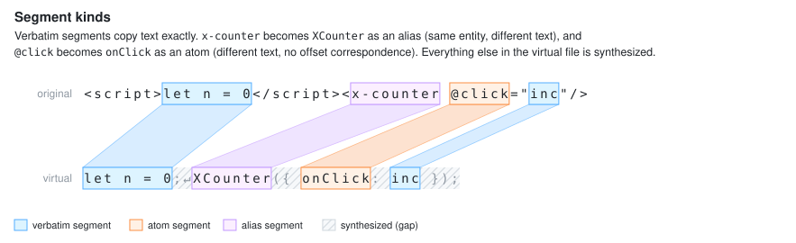

Original text may be copied into the virtual file more than once. One original position can therefore have several virtual counterparts, and this is the source of most of the interesting decisions below.

### Features

Each segment carries a [`spanmap.Feature`](../../spanmap/spanmap.go) bitmask that says which language features are allowed to use it. A mapper might, for example, copy a template expression into the virtual file twice: once in a form that type checks accurately, with `FeatureAll`, and once in a form that only exists to make completions work, with only `FeatureCompletion`. Hover would then only see the first copy.

Two things are deliberately *not* governed by features:

- **Diagnostics.** A mapper cannot hide compiler errors by turning off a feature bit. (It can suppress them with [diagnostic directives](#diagnostics).)
- **Edits.** Text edits written back to the original file use unfiltered mapping and instead require exact (verbatim) fidelity, regardless of feature bits.

### Fidelity

Every mapping result carries a `spanmap.Fidelity` describing how trustworthy it is:

| Fidelity | When | Helper predicates |
|----------|------|-------------------|
| **Exact** | The whole range is inside one verbatim segment. | `IsExact`, `IsSingleSegment` |
| **Atom** | The whole range is inside one atom or alias segment. The result is that segment's entire span on the other side. | `IsSingleSegment` |
| **Approximate** | The range crosses segment boundaries. Its endpoints are mapped (or clamped to the nearest segment edge) independently. | |
| **None** | The range is entirely synthesized, or (for `...ForFeature` APIs) some part of it is not covered by segments that enable the feature. For an entirely synthesized range, the unfiltered APIs return an *insertion point*: the original end of the preceding segment, or 0. The `...ForFeature` APIs instead return whatever the unfiltered mapping produced, which may be a non-empty range, relabeled None; callers that see None should treat the location as unusable rather than as an insertion point. | `IsNone` |

For example, with the virtual text `let n = 0;\n__ctx(n);` above:

- `n` in `let n` maps **Exact** to `n` in `<script>let n`.
- `let n = 0;\n__ctx(n)` maps **Approximate** to `let n = 0</script>\n<p>{{ n` (start of the first segment through end of the last).
- `__ctx` maps **None** to the end of `let n = 0`, the insertion point.

The same idea, drawn (the None range here is the trailing `);`, whose insertion point is after the template's `n`):

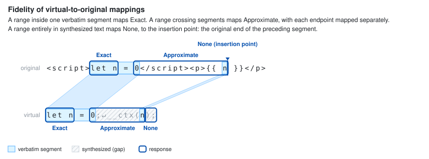

Features choose which fidelities they accept. The rough rule of thumb:

- Anything that **writes text** requires **Exact**.
- Anything that **identifies a particular token or name** (hover range, definition target, reference) requires **single-segment** (Exact or Atom).
- Anything that **decorates a region** (folding, code lens, highlights of keywords) accepts **Approximate** but drops **None**.
- **Diagnostics** accept everything, and gather None results into an aggregate diagnostic per virtual file.

### Projections

The virtual file for an original file is its **canonical projection**. A mapper may also return **supplemental** virtual files (shown as `App.vue.0.ts`, `App.vue.1.ts`, …) when it needs code in a separate module scope. Every projection has its own span map against the same original text, and all of them report locations using the original file name (`SourceFile.OriginalFileName()`).

Inbound conversions that take an original position (`FromLSPPositionForSourceFile`, `FromLSPRangeForSourceFile`, `FromLSPRangeIntersectingForSourceFile`) fan out across the canonical and all supplemental projections, returning a `Script` (the projection's `*ast.SourceFile`) with each result. In the rest of this document, "projection" means one (virtual file, virtual position) pair produced by such a call, whether it comes from a duplicated segment in one file or from a supplemental file.

### Mapping APIs

The low-level operations live in [`spanmap`](../../spanmap/spanmap.go); language features call them through [`lsconv.Converters`](../lsconv/converters.go), which also handle LSP line/character conversion and supplemental files.

**Outbound (virtual → original), one result:**

| `spanmap` | `lsconv` | Notes |
|-----------|----------|-------|
| `VirtualToOriginalSpan` | `ToLSPRange`, `ToLSPLocation` | Unfiltered. Used by diagnostics and edits. |
| `VirtualToOriginalSpanForFeature` | `ToLSPRangeForFeature`, `ToLSPLocationForFeature` | Returns None unless every character of the range is in a contiguous run of segments that enable the feature. The returned range is still the unfiltered best-effort mapping. |
| `VirtualToOriginalPosition[ForFeature]` | `ToLSPPosition[ForFeature]` | A position inside an atom maps to the atom's original start. |
| `VirtualToOriginalPositionExact` | | Also rejects a position on a segment boundary unless both sides are verbatim and contiguous in the original, since otherwise it could belong to either side. |

**Inbound (original → virtual), zero or more results:**

| `spanmap` | `lsconv` | Notes |
|-----------|----------|-------|
| `OriginalToVirtualPositions` | `FromLSPPositionForSourceFile` | Every segment containing the position. Segment ends are inclusive, so a position on the boundary between two original segments yields a result from each side. |
| `OriginalToVirtualSpans` | `FromLSPRangeForSourceFile` | If one segment contains the whole range, one Exact/Atom result per copy. If the range crosses segments, pairs each possible start with the nearest following end (Approximate). If either endpoint is uncovered, **no results**. |
| `OriginalToVirtualIntersectingSpans` | `FromLSPRangeIntersectingForSourceFile` | The intersection of the range with every enabled segment. Uncovered endpoints don't matter. Used for "visible range" requests. |

`OriginalToVirtualSpans` deserves an example because the pairing rule is subtle. If original segments `A` and `B` are each copied twice:

```
original:   [ A ][ B ]
               [---)          range from inside A to inside B

virtual:    [ A ][ B ]      [ A ][ B ]
               ^   ^          ^   ^
               1   3          11  13
```

the result is `[1,3)` and `[11,13)`, never `[1,13)`, which would cover unrelated code. Concretely:

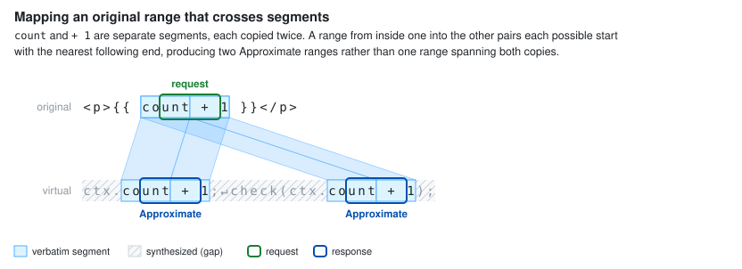

### Recurring strategies

Most features are built from a small vocabulary of choices. The per-feature sections below use these terms.

**Inbound fan-out:** what to do with several projections of the request position.

- **All projections.** Run the feature once per projection and combine the results (hover, definition, references, …).
- **First that answers.** Try projections in order and return the first non-empty result (signature help).
- **Exactly one.** Bail out unless there is exactly one projection, because the feature's answer would be ambiguous otherwise (linked editing, auto-insert, selection ranges).
- **First only.** Use `positions[0]` (completions).

**Outbound gating:** which fidelity a result needs in order to be reported.

- **Exact**: the result is dropped (or the request returns nothing) unless it maps verbatim.
- **Single-segment**: Exact or Atom.
- **Not None**: Approximate is fine; synthesized results are dropped.
- **Anything**: no gating; None is given a fallback location.

**Combination:** how results from several projections become one response.

- **Concatenate**: all results are shown (hover).
- **Deduplicate**: identical results are collapsed, typically by original location (definitions, references, highlights, folding, symbols, code lens).
- **Detect conflicts**: identical results are collapsed, and *differing* results for the same location fail the whole response or file (rename within one project; the change tracker when a file's edits come from more than one virtual file).
- **Partition**: each original position is served by exactly one projection (formatting).

## Summary table

| Feature | Inbound | Fan-out | Outbound gating | Combination |
|---------|---------|---------|-----------------|-------------|
| Diagnostics | — | All projections | Anything; None → one aggregate per virtual file | Concatenate |
| Hover | Position | All | Range kept only if single-segment | Concatenate |
| Signature help | Position | First that answers | — | First wins |
| Completions | Position | First only, must be Exact | Replacement ranges Exact | — |
| Definition / type def. | Position | All single-segment | Target name single-segment | Dedupe by location |
| References / implementation | Position | All single-segment | Single-segment | Dedupe by location |
| Rename | Position | All; prepare needs Exact | Exact, per occurrence | Dedupe; conflict → null |
| Document highlights | Position | All single-segment | Not None | Dedupe by range |
| Linked editing | Position | Exactly one, Exact | Exact | — |
| Auto-insert (VS) | Position | Exactly one, Exact | Echoes request position | — |
| Call hierarchy | Position | All single-segment | Selection single-segment; ranges not None (incoming-call search uses `FeatureReferences`) | Dedupe declarations |
| Formatting (document/range) | Range | Partition by original position | Exact, inside requested range | Partition |
| On-type formatting | Position | Exactly one, Exact | Exact, all-or-nothing | — |
| Code actions | Range | All | Exact (change tracker) | Dedupe actions; cross-file conflict → drop file |
| Code lens | — | All projections | Not None | Dedupe by range and kind |
| Inlay hints | Range | Intersecting segments | Position not None | Concatenate |
| Semantic tokens | (Range) | All / intersecting | Exact | Dedupe by start |
| Folding ranges | — | All projections | Not None | Dedupe |
| Selection ranges | Position | Exactly one, single-segment | Not None | — |
| Document symbols | — | All projections | Name single-segment | Dedupe by name, kind, range |
| Workspace symbols | — | Each file | Name single-segment | — |

## Feature by feature

### Diagnostics

**Code:** [`diagnostics.go`](../diagnostics.go), `lsconv.DiagnosticToLSP*` in [`converters.go`](../lsconv/converters.go), `applyContentMapperDiagnosticDirectives` in [`compiler/program.go`](../../compiler/program.go), `displayMessageArgs` in [`ast/diagnostic.go`](../../ast/diagnostic.go).

Diagnostics are gathered from the canonical projection and every supplemental projection, then mapped outward with the **unfiltered** `VirtualToOriginalSpan`. There is no feature bit for diagnostics, and any fidelity is accepted. An error whose span crosses from verbatim script into synthesized glue is reported at the Approximate range rather than being lost.

**Synthesized locations.** A diagnostic whose span is entirely synthesized (fidelity None) has no meaningful location. Rather than dropping it or reporting it at an arbitrary insertion point, such diagnostics are grouped by virtual file and each group is replaced by one aggregate diagnostic: *"Virtual code produced by the content mapper '{0}' has problems with no corresponding location in this file."* Because the canonical and supplemental projections are separate virtual files, one original document can receive several aggregates. The aggregate is created at virtual offset 0 and mapped like any other diagnostic: if offset 0 is synthesized (the usual case), it lands at the top of the original file, but if the virtual file begins with a segment, it lands wherever that segment maps. The real diagnostics are attached as related information, and the aggregate takes the most severe category among them. Related information whose location is None is reported with an empty range.

> **Example.** A mapper emits `const __props: Props = {}` as glue, and `Props` has a required member. The resulting "Property 'x' is missing" error sits entirely in synthesized text. Since the virtual file starts with synthesized text, the editor shows the aggregate at line 1, column 1, of `App.vue`, with the original message as related information.

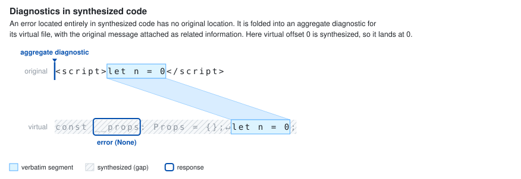

**Mapper-provided diagnostics.** Diagnostics the mapper itself reports (those with a non-empty `Source`) are already in original coordinates and are not mapped.

**Directives.** A mapper can attach diagnostic directives to a virtual range, similar to `// @ts-ignore` and `// @ts-expect-error`. Any compiler diagnostic that *starts* inside a directive's virtual range is suppressed. An `Expect` directive that suppresses nothing produces the mapper-supplied "unused" error at the directive's original range.

**Alias names in messages.** When a diagnostic's span is *exactly* one alias segment, each message argument that is *equal to* the virtual name is replaced with the original text. Arguments that merely contain the name, like a type `typeof XCounter`, are left alone. If `<x-counter>` aliases `XCounter`, *"'XCounter' is declared but never used"* is displayed as *"'x-counter' is declared but never used."* A diagnostic that only partially overlaps the alias is left alone. The stored arguments are unchanged, so code fixes still see the virtual name.

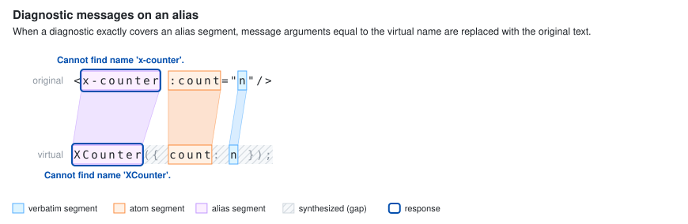

### Hover

**Code:** [`hover.go`](../hover.go).

1. The cursor is projected with `FromLSPPositionForSourceFile(…, FeatureHover)`. Projections that are not single-segment are skipped.
2. Hover runs once for every remaining projection.
3. Every projection that yields a hover contributes its content; the response shows them all.
4. The hover's `range` (the span highlighted in the editor) is set only if the hovered node maps single-segment with `FeatureHover`. Otherwise the hover is still shown, just without a highlighted range.

Links inside JSDoc (`{@link Foo}`) are resolved to locations with the same feature filter.

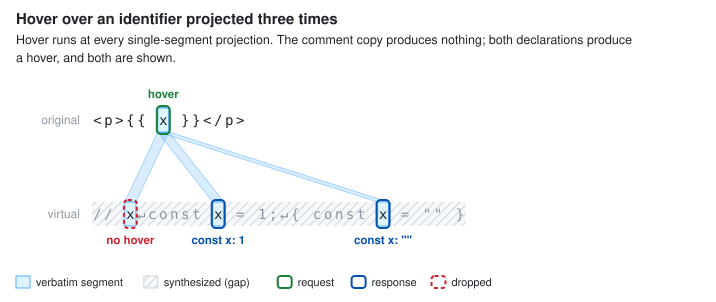

### Signature help

**Code:** [`signaturehelp.go`](../signaturehelp.go).

The cursor is projected with `FeatureSignatureHelp`, skipping non-single-segment projections. Projections are tried in order, and the **first non-empty** signature help result wins. Signature help is a modal UI with one active signature and parameter, so showing several would be confusing, and in practice the extra projections are often in places like comments where there is no call.

> **Example.** The original `use(1)` is copied into a comment `// use(1)` and into executable code. The comment projection produces no signature help, so the executable copy's result is shown.

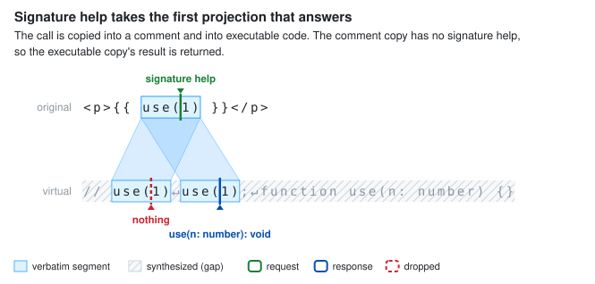

### Completions

**Code:** [`completions.go`](../completions.go), [`string_completions.go`](../string_completions.go).

Completions are the strictest inbound feature: they take **only the first projection** (`positions[0]`) from `FromLSPPositionForSourceFile(…, FeatureCompletion)`, and it must be **Exact**. Otherwise there are no completions. An atom is never acceptable because the cursor's offset within the identifier being typed matters.

Every range in a completion item is a text edit, so every one must map **Exact**:

- If an item needs its own replacement span (e.g. converting `a.b` to `a?.["b-c"]`, or a JSX closing tag) and that span does not map exactly, the item is **dropped**, since accepting it would write text at the wrong place.
- If the list's default replacement span (the identifier being typed) does not map exactly, it is omitted and the client falls back to its own word-range heuristic.
- Optional ranges, like the text to erase when completing a class member after existing modifiers, are omitted when inexact.
- Path completions in string literals compute their replacement span the same way.

Additional edits attached to an item (auto-imports, `override` member snippets) are produced by the [change tracker](#code-actions-and-other-edits-the-change-tracker), so they follow its all-or-nothing rule per file.

> **Example.** In `<p>{{ user.na| }}</p>`, the mapper copies `user.na` verbatim. The cursor maps Exact, so we compute completions for `user.`, and the replacement span for `name` covers `na`, which also maps exactly. If the mapper had instead emitted `user.na` as an atom, there would be no completions.

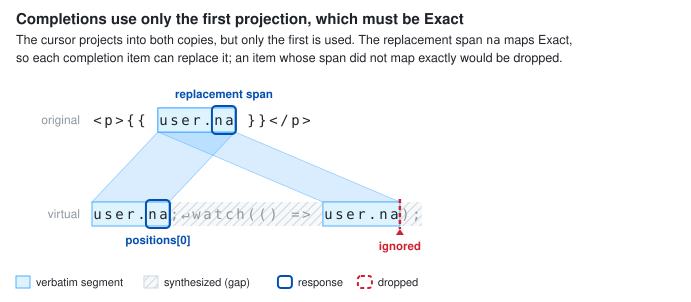

### Go to definition, type definition, source definition

**Code:** [`definition.go`](../definition.go), [`sourcedefinition.go`](../sourcedefinition.go), [`source_map.go`](../source_map.go).

1. **Inbound:** all projections of the cursor with `FeatureDefinition` (or `FeatureTypeDefinition`), skipping non-single-segment ones. Each runs independently.
2. **Outbound, target:** each declaration found is converted to a location whose `targetSelectionRange` is the declaration's *name*. The name must map **single-segment** with the feature, or that declaration is skipped. A declaration whose name the mapper synthesized (e.g. a generated `__VLS_ctx` binding) is not navigable.
3. **Outbound, context:** the `targetRange` (the whole declaration, used for peek previews) is mapped unfiltered. If it is None, maps to a different file, or does not contain the selection range, it falls back to the selection range.
4. **Origin range:** the `originSelectionRange` (the span under the cursor the editor underlines) is mapped unfiltered and is not gated on fidelity.
5. **Combination:** results from all projections are deduplicated by location.

Targets in a content-mapped file are reported by the original file's URI. Targets in `.d.ts` files with declaration maps are additionally traced through the declaration map ([`source_map.go`](../source_map.go)).

> **Example.** `App.vue` imports `Child.vue` and uses `<Child :msg="…">`. If `Child.vue`'s mapper emits its props declaration with `msg` as a verbatim segment, go to definition on `msg` lands on `msg` in `Child.vue`. If the mapper synthesizes the props type instead, there is no navigable target.

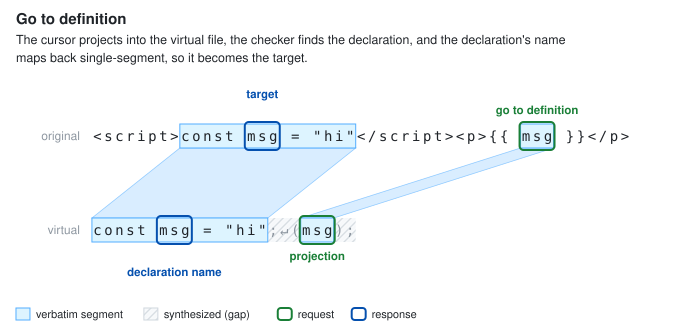

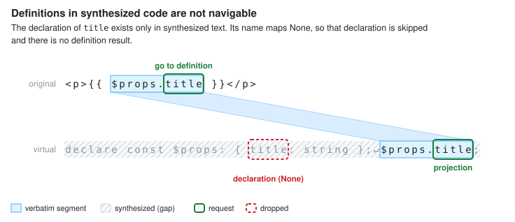

### Find all references and go to implementation

**Code:** [`findallreferences.go`](../findallreferences.go).

1. **Inbound:** all single-segment projections of the cursor (with `FeatureReferences`, `FeatureImplementation`, or, when called on behalf of rename, `FeatureRename`). Each projection runs its own search and the entries are concatenated.
2. **Outbound:** every reference must map **single-segment** with the feature. A reference in synthesized code (fidelity None) or crossing segments is dropped. An Atom is acceptable here even though it isn't for rename: the location is still meaningful to look at.
3. **Context ranges** (the enclosing declaration, for previews) are mapped with the feature filter and used only if not None and in the same file.
4. **Combination:** deduplicated by location (references) or by node (implementations), so a symbol referenced in a script block that is projected twice is listed once.

> **Example.** `count` is declared in `<script setup>` and used in `{{ count }}`. The mapper also emits `count` inside a generated `__VLS_ctx = { count }` object (synthesized). References lists the declaration and the template use, but not the generated one.

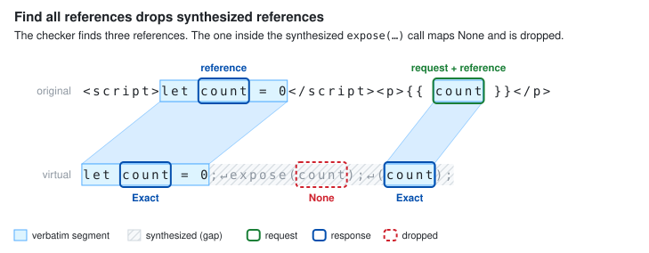

### Rename

**Code:** [`rename.go`](../rename.go), [`findallreferences.go`](../findallreferences.go).

Rename writes text, so it is gated on **Exact** throughout.

- **Prepare rename** requires an Exact projection of the cursor, and the trigger span (the identifier the editor highlights for renaming) must map Exact. Renaming from inside an atom is refused.
- **Rename** finds references through all projections (`FeatureRename`), then maps each occurrence with the unfiltered `ToLSPRange`. Each occurrence must be **Exact**; an occurrence that isn't is **skipped**, and the rest of the rename proceeds.
- **Deduplication:** identical edits (same file, range, and new text) are collapsed. If two edits target the same range with *different* text, the rename is ambiguous and returns **null**. This check applies to each project's result. When a rename spans several projects, the cross-project combiner only dedupes edits by range and does not compare their text.

When the script is projected twice, the same rename runs against both copies and produces duplicate edits, which collapse:

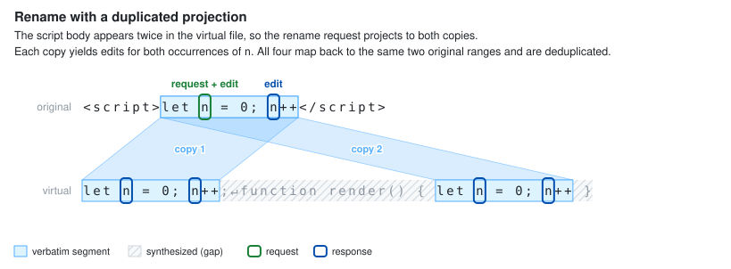

When one occurrence maps through an atom or alias, that occurrence is skipped and the rest are renamed:

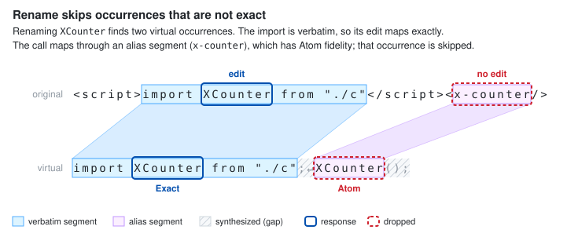

Skipping is a deliberate trade-off: the alternative would be refusing the whole rename because of an occurrence the user cannot edit precisely. Mappers that want such occurrences renamed should emit them as verbatim segments.

### Document highlights

**Code:** [`documenthighlights.go`](../documenthighlights.go).

All single-segment projections of the cursor (`FeatureDocumentHighlights`) are queried. Each highlight range is mapped with the feature filter and dropped if None. Approximate is allowed, which matters for keyword highlights like `if`/`else` that may span segments, but highlights derived from references are already single-segment. Results are deduplicated by file and range.

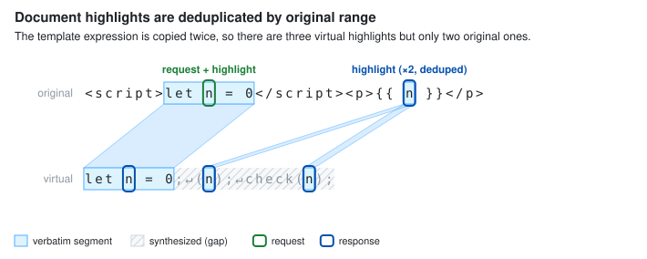

### Linked editing and auto-insert

**Code:** [`linkedediting.go`](../linkedediting.go), [`autoinsert.go`](../autoinsert.go).

These features act on every keystroke and edit text in several places at once, so ambiguity is unacceptable. Both require **exactly one** projection, and it must be **Exact**.

- **Linked editing** (JSX tag pairs) requires both returned ranges to map Exact with `FeatureLinkedEditing`; otherwise it returns nothing.
- **Auto-insert** (Visual Studio's closing-tag and quote insertion) returns text to insert at the client's own position, so it echoes the original request position rather than mapping one back.

> **Example.** A mapper that copies a JSX block into two places makes linked editing unavailable there: typing in `<div>` could correspond to either copy's `</div>`.

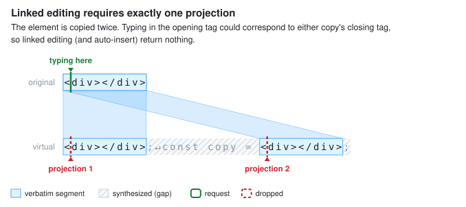

### Call hierarchy

**Code:** [`callhierarchy.go`](../callhierarchy.go).

- **Inbound:** all single-segment projections with `FeatureCallHierarchy`. Declarations found from several projections are deduplicated.
- **Items:** the `selectionRange` (the function's name) must be single-segment or the item is dropped. The `range` (the whole declaration) falls back to the selection range if None or if it does not contain it.
- **Callers:** a call is attributed to its nearest enclosing call hierarchy declaration: a named function, method, or class, or a function/class expression assigned to a `const` variable or class property. A call that has no such ancestor is attributed to the source file. A function expression in any other position, like an object literal property value, is not a caller in its own right.
- **Calls:** each `fromRanges` entry is the callee expression at a call site (e.g. `inc` in `inc()`, not the whole call), and is dropped if None.
- **Incoming calls, feature filter:** the target declaration's location must not map None with `FeatureCallHierarchy`. The reference search that finds call sites, though, goes through the find-all-references machinery, which filters with `FeatureReferences`. A call site in a segment with only one of these features enabled behaves accordingly.

> **Example.** A template event handler `@click="inc()"` becomes `const onClick = () => inc()`. Incoming calls for `inc` find the call inside the arrow function, whose nearest caller declaration is the `const onClick` arrow. The callee `inc` is verbatim, so its `fromRange` maps Exact. The caller's name, `onClick`, maps through an atom to `@click`; that is single-segment, so the caller item is kept and points at the attribute. Had the mapper emitted `({ onClick: () => inc() })`, the arrow would not be a caller declaration and the call would be attributed to the virtual source file instead.

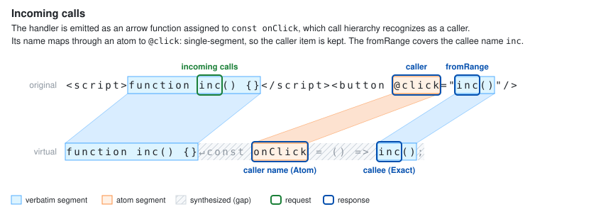

### Formatting

**Code:** [`format.go`](../format.go).

**Document and range formatting** are the most intricate. Formatting text that the mapper copied twice must not produce two sets of edits for the same original text, and edits must never touch text the mapper didn't copy verbatim.

1. **Collect** every verbatim segment with `FeatureFormatting` that intersects the requested original range (the whole document for document formatting), across all projections, and clip it to the requested range.
2. **Partition:** when several virtual ranges cover the same original text, each original position is assigned to only one of them. Ranges are considered by earliest original start, then longest; a later range is trimmed to the part not already covered, or dropped if fully covered.
3. **Format** each remaining virtual range.
4. **Filter:** an edit is kept only if it lies inside its virtual range and maps **Exact**.
5. **Sort** all edits by original position.

> **Example.** Suppose a `<script>` body is projected twice, once at module scope and once indented inside a `function render() { … }`. Partitioning assigns the script to the first copy only, so the formatter's notion of indentation comes from the module-scope copy and the user doesn't receive two conflicting reindentations. If the second copy also contained a template expression not present in the first, that part would be formatted from the second copy.

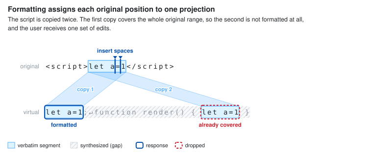

**On-type formatting** (after `;`, `}`, newline) requires **exactly one Exact** projection of the cursor. All resulting edits must map Exact; if any one doesn't, **no edits** are returned, because a partial set of formatting edits can leave code half-indented.

### Code actions and other edits (the change tracker)

**Code:** [`codeactions.go`](../codeactions.go), [`change/tracker.go`](../change/tracker.go), [`change/trackerimpl.go`](../change/trackerimpl.go).

**Inbound.** Quick fixes receive diagnostics from the client in original coordinates. Each diagnostic's range is projected with `FromLSPRangeForSourceFile(…, FeatureCodeActions)`, and every code fix provider runs once per projection. Identical actions produced by several projections or several diagnostics are deduplicated as actions. Each action builds its edits in its own change tracker, so the tracker rules below apply within one action, not across separately returned actions.

**Outbound.** Everything that builds edits from AST manipulations (quick fixes, organize imports, auto-import additional edits, member completions, file rename import updates) goes through the change tracker, which applies these rules per original file:

- **Edit ranges** must map **Exact**. When an edit's location is given as an original position, the tracker picks the Exact projection in the same virtual file.
- **Inserted text** is formatted at every Exact projection of the insertion point, including duplicate copies within one virtual file. If the copies disagree on the formatted text (say, because one is more deeply indented), the file is unmappable.
- **Insertion at the top of the file** skips the mapper's synthesized header and inserts before the first verbatim segment, so imports land inside `<script>` rather than at byte 0 of `App.vue`.
- **Indentation** of multi-line insertions is recomputed from the original text, so code inserted into an indented `<script>` block matches its surroundings.
- **Combining virtual files:** an original file's edits may come from more than one virtual file in the tracker (the canonical projection and supplemental ones). Only in that case are identical edits collapsed, and overlapping edits or different insertions at the same point make the file unmappable.
- **Edits within one virtual file** are handled as for an ordinary file: nothing is deduplicated, several insertions at the same point are allowed, and overlapping edits are a bug (the tracker panics). A mapper that duplicates text within one virtual file does not by itself make a fix produce duplicate edits, because a fix normally edits the one node it was given.

An unmappable file is **all-or-nothing**: `GetChanges` returns no edits for it and reports its name, so callers can discard a fix entirely rather than apply part of one. Several callers (e.g. "implement interface", auto-import fixes) discard the whole action when any file is unmappable.

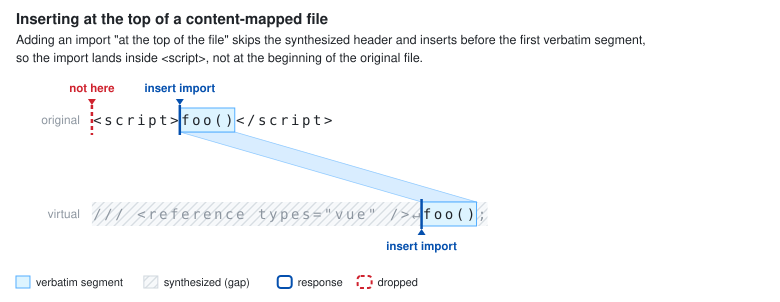

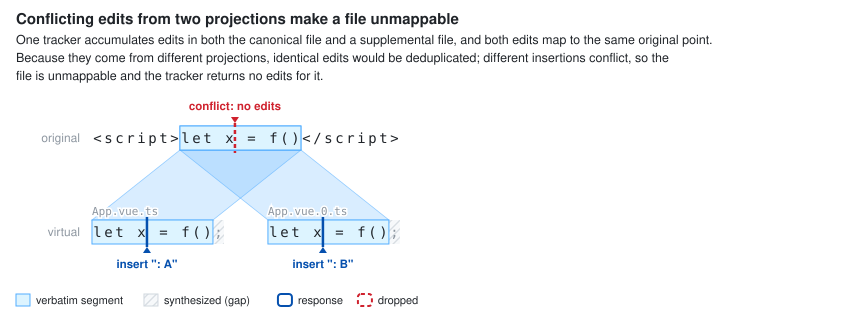

### Code lens

**Code:** [`codelens.go`](../codelens.go).

Code lenses are collected from every projection. Each lens's range is mapped with `FeatureCodeLens` and dropped if None. Lenses are deduplicated by range and kind (references vs. implementations). The lens's data records which projection (`SupplementalFileIndex`) it came from, so that resolving it later (counting references) runs against the same virtual file.

Because the lens range is mapped with the feature filter, a declaration whose body contains injected synthesized code gets no lens:

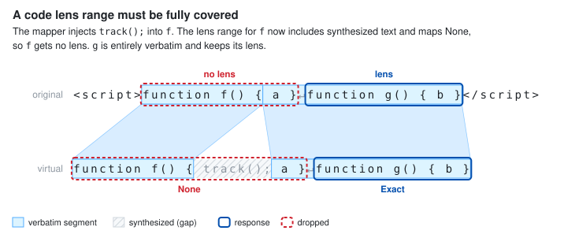

### Inlay hints

**Code:** [`inlay_hints.go`](../inlay_hints.go).

Inlay hints are requested for the visible range, which may include large stretches of template markup with no virtual counterpart. They therefore use `FromLSPRangeIntersectingForSourceFile(…, FeatureInlayHints)`, which returns the intersection of the visible range with every enabled segment, ignoring uncovered endpoints. Each intersection is visited for hints.

- Each hint's position is mapped with the feature filter and dropped if None. A hint positioned inside an atom appears at the atom's original start.
- A clickable label part (e.g. a parameter name linking to its declaration) gets a location only if it maps single-segment.
- Hints from different intersections are concatenated; they are not deduplicated, so a mapper that duplicates code with `FeatureInlayHints` enabled on both copies will produce duplicate hints.

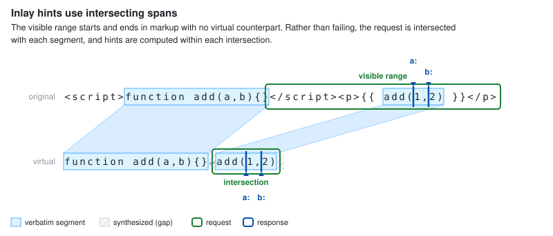

### Semantic tokens

**Code:** [`semantictokens.go`](../semantictokens.go).

- **Full document:** tokens are collected from every projection.
- **Range:** uses `FromLSPRangeIntersectingForSourceFile(…, FeatureSemanticTokens)`, like inlay hints, and deduplicates tokens collected from overlapping intersections.

Each token must map **Exact**. A semantic token colors specific characters, so an atom (whose text differs) or an approximate range would color the wrong text. Tokens are sorted by original position, and when several projections produce a token at the same start, the first one after sorting is kept.

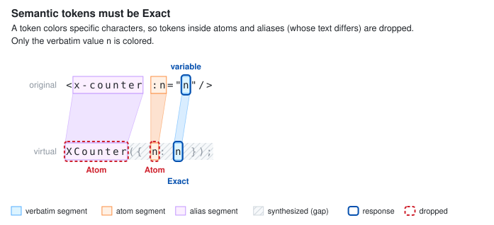

### Folding ranges

**Code:** [`folding.go`](../folding.go).

Folding ranges are collected from every projection. Each range is mapped with `FeatureFoldingRanges` and dropped if None; Approximate is acceptable, since a fold that begins in one segment and ends in another is still a sensible fold. Results are sorted and deduplicated.

A fold whose range includes synthesized text maps None, so a function the mapper wraps around the script contributes no fold:

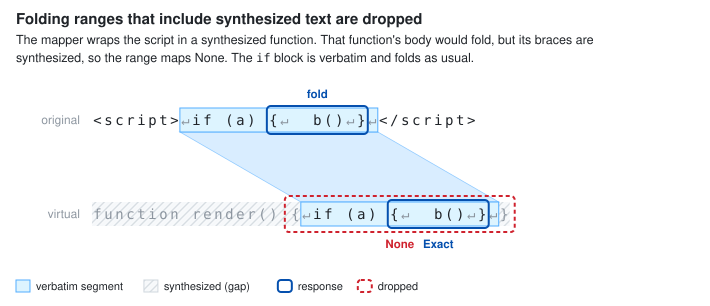

For clients that only fold whole lines, the end line is pulled back by one when the fold ends with a closing bracket, so the bracket stays visible. This needs to know the character at the fold's end, which is found by mapping the end position back into the virtual file.

### Selection ranges

**Code:** [`selectionranges.go`](../selectionranges.go).

Each requested position must have **exactly one single-segment** projection (`FeatureSelectionRanges`); otherwise the whole request returns null. Expanding selection is a sequence of nested ranges, and two projections would produce two incompatible sequences.

Each candidate range in the sequence is mapped with the feature filter and skipped if None. Consecutive candidates that map to the same original range are collapsed, which is common when nested virtual nodes differ only by synthesized wrapper text. For example, if `{{ a.b }}` becomes `__ctx(a.b);`, expanding from `b` yields `b`, then `a.b`; the enclosing call `__ctx(a.b)` and the statement contain synthesized text, map None, and are skipped. For content-mapped files, the outermost "entire file" range is omitted, since the virtual file's extent is not the original file's.

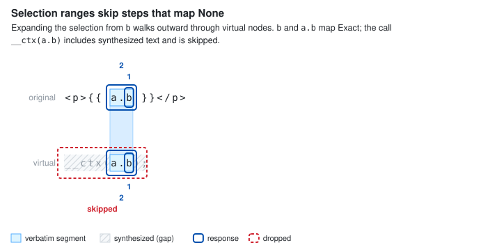

### Document symbols and workspace symbols

**Code:** [`symbols.go`](../symbols.go).

**Document symbols** are collected from every projection. A symbol's `selectionRange` (its name) must map **single-segment** with `FeatureDocumentSymbols`, or the symbol is dropped. Its `range` (the whole declaration) falls back to the selection range if None. Symbols are deduplicated by name, kind, and range.

> **Example.** A mapper emits a synthesized `function render() {}` for the template. `render` doesn't appear in the outline, while `function inc()` written in `<script>` does.

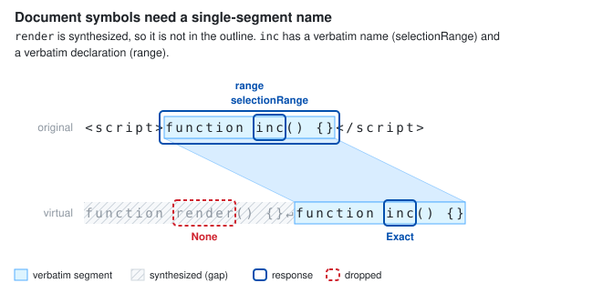

**Workspace symbols** map each declaration's name the same way, skipping names that aren't single-segment.
